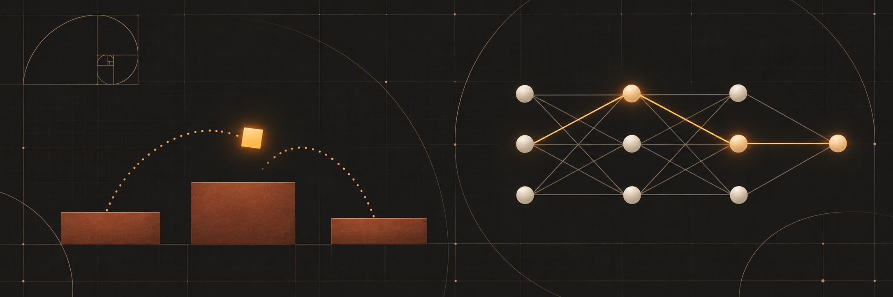
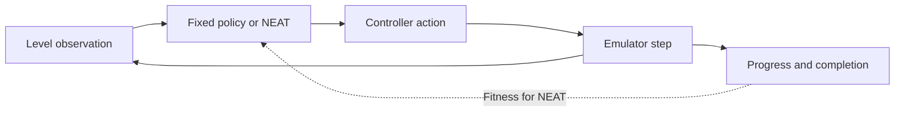

# Mario Player using Neuroevolution



**Can an evolved controller clear more of a level than a fixed jump policy?** This project explores that question with NEAT, which evolves a network’s connections and weights across generations.

**Python 3.10+** · **Fixed-policy demo available** · **Training planned**

[Quick start](#quick-start) · [Experiment design](#experiment-design) · [Repository guide](#repository-guide)

## Quick start

From the repository root, run the standard-library demo.

```sh
python src/baseline.py
```

```text
0: right, jump
7: right, jump
8: right
39: right
40: right, jump
```

The policy holds right and jumps for the first eight frames of each 40-frame cycle. The script prints the actions at the cycle boundaries. An emulator adapter is the next milestone.

## Experiment design

The planned benchmark compares the fixed policy and an evolved NEAT network using the same starting states and frame budget.



| Controller | Role in the comparison |
| --- | --- |
| Fixed right-and-jump policy | Establish the reference score. |
| NEAT controller | Test whether evolution improves on that reference. |

For both controllers, report maximum horizontal progress, frames survived and completion rate on held-out starting states. Start with one reproducible episode. Once reset and step are stable, train across several seeds and record each generation’s fitness. Keep game assets local.

## Repository guide

- [Fixed policy](src/baseline.py) — deterministic actions and the runnable demo.
- [First benchmark](experiments/README.md) — emulator integration and evaluation steps.
